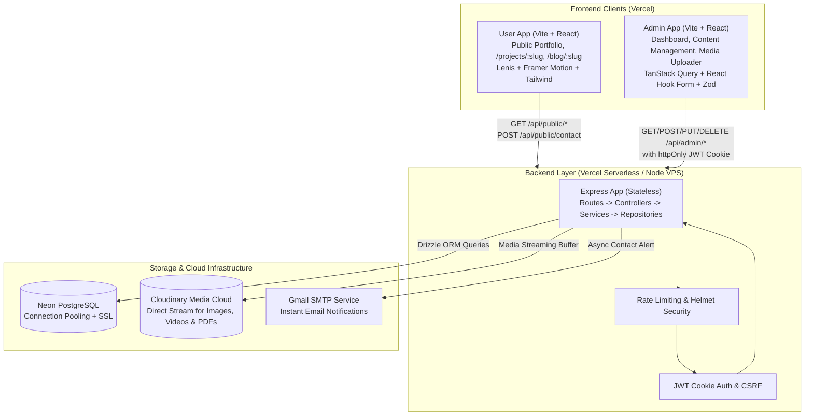

# Architecture Documentation

## 1. Overall System Architecture
The application is structured as a decoupled full-stack system consisting of two independent client applications (`User/` and `Admin/`), a dual-target REST API (`Backend/`), and external managed services operating within a ₹0/month operational budget.

---

## 2. Technology Stack & Component Responsibilities

| Subsystem | Technology | Responsibility |
| :--- | :--- | :--- |
| **User Application** | React 18, Vite, Tailwind CSS, Framer Motion, Lenis | Public visitor experience, smooth scrolling, micro-interactions, dark/light theme, responsive layout. |
| **Admin Application** | React 18, Vite, Tailwind CSS, TanStack Query, React Hook Form, Zod | Protected administration console, data tables, reordering, visibility switches, media uploading. |
| **Backend REST API** | Node.js, Express, TypeScript | Business logic, authentication, request validation, database interactions, media streaming, notifications. |
| **ORM & Migrations** | Drizzle ORM, Drizzle Kit | Type-safe schema definition, SQL migration generation, query execution. |
| **Database** | PostgreSQL 16 (Local Dev / Neon Serverless Prod) | Relational persistence with connection pooling. |
| **Media Cloud** | Cloudinary | Asset storage, image transformations, resume PDF downloads. |
| **Mailing** | Nodemailer (Gmail SMTP) | Transactional contact notifications. |

---

## 3. Data Flow Between Major Components

### 3.1 Public Portfolio Consumption
1. **Initial Page Load:** The User App queries `GET /api/public/portfolio`.
2. **Aggregated Fetch:** The controller queries repositories for all items marked `is_visible: true`, sorted by `display_order ASC`.
3. **Optimized Delivery:** A consolidated JSON object containing hero, about, categorized skills, experiences, projects, education, certifications, and testimonials is delivered to the client in a single round-trip.
4. **Client-Side Rendering:** React renders sections with skeleton loading states, followed by staggered Framer Motion reveal animations.

### 3.2 Contact Form Submission & Email Flow
1. Visitor fills out the Contact form on the public site.
2. User App validates input via Zod, then dispatches `POST /api/public/contact`.
3. Backend validates payload with Zod.
4. Repository persists message into `messages` table with `is_read = false`.
5. Service asynchronously triggers `Nodemailer` to send an email notification to the administrator's inbox.
6. Returns `201 Created` with `{ success: true, message: "Message sent successfully" }`.

### 3.3 Admin Authentication & Session Management
1. Administrator posts credentials to `POST /api/admin/auth/login`.
2. Controller passes credentials to `AuthService`.
3. Password verified using `bcrypt.compare` against hashed password in `admin_users`.
4. Stateless JWT token generated with expiration (e.g., 7 days).
5. Token set in `httpOnly`, `Secure`, `SameSite=Lax` cookie.
6. Subsequent admin requests authenticate transparently via cookie.

---

## 4. Dual Deployment Architecture (Vercel Serverless & VPS)
- **Vercel Serverless Handler:** `Backend/api/index.ts` exports the Express `app` directly for Vercel's Fluid Compute engine.
- **Standalone VPS Runner:** `Backend/src/server.ts` imports the same Express `app` and initiates `app.listen(PORT)` with graceful shutdown handlers (`SIGTERM`, `SIGINT`).
- **Zero Ephemeral Disk Dependency:** Uploaded files are piped through memory buffers directly to Cloudinary.

