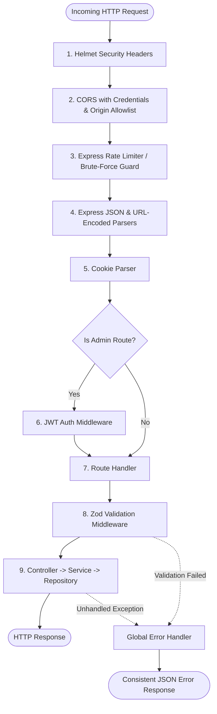
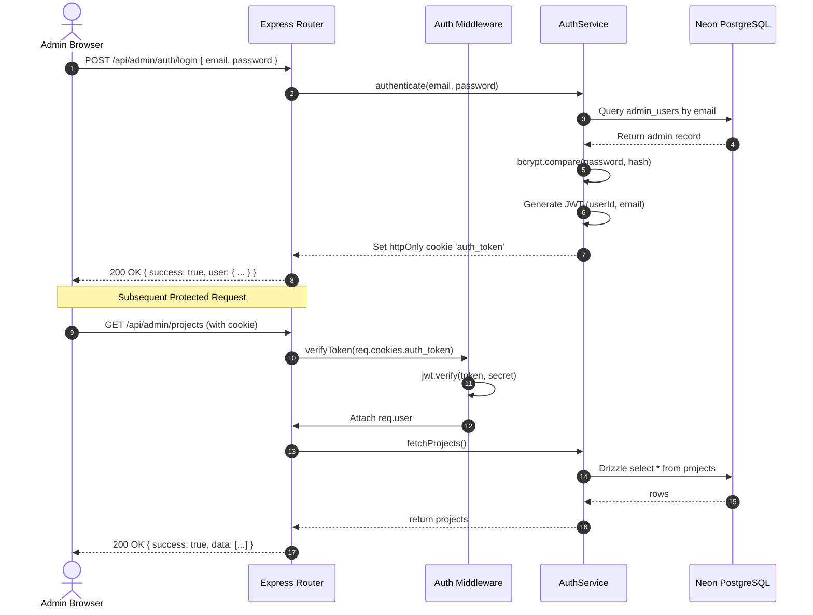

# Backend Architecture & Request Flow

## 1. Backend Directory Structure
```text
Backend/
├── api/
│   └── index.ts                 # Vercel Serverless Function entry point
├── drizzle.config.ts            # Drizzle Kit configuration
├── package.json
├── tsconfig.json
└── src/
    ├── server.ts                # Standalone HTTP server runner (app.listen)
    ├── app.ts                   # Express application setup & middleware assembly
    ├── config/
    │   ├── env.ts               # Zod-validated environment configuration
    │   ├── db.ts                # Drizzle ORM + Neon connection pooler
    │   └── cloudinary.ts        # Cloudinary SDK configuration
    ├── db/
    │   ├── schema.ts            # Drizzle table schemas and relations
    │   ├── migrate.ts           # Programmatic migration runner
    │   ├── seed.ts              # Database seeder (Admin user & initial portfolio)
    │   └── migrations/          # Generated SQL migration files
    ├── middleware/
    │   ├── auth.middleware.ts   # JWT verification from httpOnly cookie
    │   ├── error.middleware.ts  # Global error handling and formatting
    │   ├── rateLimiter.ts       # Rate limiting configuration
    │   └── upload.middleware.ts # Multer memory buffer configuration
    ├── validators/              # Zod validation schemas for requests
    ├── routes/                  # Express route modularization
    │   ├── index.ts             # Gateway router (/api/public, /api/admin)
    │   ├── public.routes.ts
    │   ├── auth.routes.ts
    │   └── admin.routes.ts
    ├── controllers/             # HTTP transport layer (parsing, status codes)
    ├── services/                # Business logic, Cloudinary, Nodemailer
    └── repositories/            # Drizzle ORM database access layer
```

---

## 2. Middleware Execution Order
Every incoming HTTP request passes through this strict pipeline:



---

## 3. Request & Response Lifecycle

### Standard Request Processing Flow
1. **Routing:** Incoming request routed to either `/api/public` or `/api/admin`.
2. **Validation:** Inbound body, query, and params validated against a strictly typed Zod schema via a generic `validate(schema)` middleware. If invalid, a `400 Bad Request` is returned with an actionable error array.
3. **Controller Execution:** Controllers extract validated data, delegate business logic to services, and format the HTTP response.
4. **Service Layer:** Orchestrates business operations, database queries via repositories, file uploads to Cloudinary, or email dispatch via Nodemailer.
5. **Repository Layer:** Executes parameterized SQL queries via Drizzle ORM against PostgreSQL.
6. **Unified Response Format:**
   ```json
   {
     "success": true,
     "data": { ... },
     "message": "Optional contextual message"
   }
   ```
7. **Unified Error Format:**
   ```json
   {
     "success": false,
     "error": {
       "code": "VALIDATION_ERROR",
       "message": "Invalid request parameters",
       "details": [ ... ]
     }
   }
   ```

---

## 4. Authentication & Authorization Flow


---

## 5. Media Upload Flow (Cloudinary Buffer Stream)
To support Vercel's serverless environment where disk persistence is unavailable:
1. Multer receives file in memory buffer (`storage: multer.memoryStorage()`).
2. Mime-type and file size validated (Images: max 5MB, PDF: max 10MB).
3. `StorageService` streams buffer directly to Cloudinary using `cloudinary.uploader.upload_stream`.
4. Cloudinary generates optimized secure URL and unique `public_id`.
5. Metadata recorded in `media` table.
6. Response returns `{ secure_url, public_id }` for attachment to project, settings, or blog records.

