# Database Architecture & Schema Specification

## 1. Database Overview
- **Database Engine:** PostgreSQL (Version 16 compatible)
- **Deployment Environments:**
  - **Local Development:** Local PostgreSQL 16 on Windows (or Docker)
  - **Production:** Neon Serverless PostgreSQL with Connection Pooling (`sslmode=require`)
- **Migration & Schema Management:** Drizzle ORM (`drizzle-orm`) & Drizzle Kit (`drizzle-kit`)
- **Primary Key Strategy:** UUID v4 (`uuid_generate_v4()` or application-generated `crypto.randomUUID()`) for high entropy, non-enumerable IDs, and seamless distributed data generation.

---

## 2. Entity-Relationship Diagram

```mermaid
erDiagram
    ADMIN_USERS {
        uuid id PK
        varchar(255) email UK
        varchar(255) password_hash
        varchar(255) full_name
        timestamp created_at
        timestamp updated_at
    }

    SITE_SETTINGS {
        uuid id PK
        varchar(255) full_name
        varchar(255) title
        varchar(255) tagline
        text bio
        text avatar_url
        text resume_url
        varchar(255) contact_email
        varchar(50) contact_phone
        varchar(255) location
        varchar(50) primary_accent
        text seo_title
        text seo_description
        timestamp updated_at
    }

    SOCIAL_LINKS {
        uuid id PK
        varchar(100) platform
        text url
        varchar(100) icon_key
        integer display_order
        boolean is_visible
        timestamp created_at
    }

    SKILL_CATEGORIES {
        uuid id PK
        varchar(100) name UK
        integer display_order
        boolean is_visible
        timestamp created_at
    }

    SKILLS {
        uuid id PK
        uuid category_id FK
        varchar(100) name
        integer proficiency_percentage
        varchar(100) icon_key
        integer display_order
        boolean is_visible
        timestamp created_at
    }

    EXPERIENCES {
        uuid id PK
        varchar(255) company
        varchar(255) role
        varchar(255) location
        varchar(100) employment_type
        varchar(100) start_date
        varchar(100) end_date
        boolean is_current
        text description
        text[] achievements
        integer display_order
        boolean is_visible
        timestamp created_at
    }

    PROJECTS {
        uuid id PK
        varchar(255) title
        varchar(255) slug UK
        text summary
        text description
        text thumbnail_url
        text[] gallery_urls
        text[] tags
        text live_url
        text github_url
        boolean is_featured
        integer display_order
        boolean is_visible
        timestamp created_at
        timestamp updated_at
    }

    BLOG_POSTS {
        uuid id PK
        varchar(255) title
        varchar(255) slug UK
        text excerpt
        text content
        text cover_image_url
        text[] tags
        integer reading_time_minutes
        boolean is_published
        timestamp published_at
        timestamp created_at
        timestamp updated_at
    }

    EDUCATION {
        uuid id PK
        varchar(255) institution
        varchar(255) degree
        varchar(255) field_of_study
        varchar(100) start_date
        varchar(100) end_date
        varchar(50) grade
        text description
        integer display_order
        boolean is_visible
        timestamp created_at
    }

    CERTIFICATIONS {
        uuid id PK
        varchar(255) name
        varchar(255) issuer
        varchar(100) issue_date
        text credential_url
        text certificate_image_url
        integer display_order
        boolean is_visible
        timestamp created_at
    }

    TESTIMONIALS {
        uuid id PK
        varchar(255) author_name
        varchar(255) author_role
        varchar(255) author_company
        text avatar_url
        text quote
        integer rating
        integer display_order
        boolean is_visible
        timestamp created_at
    }

    MESSAGES {
        uuid id PK
        varchar(255) sender_name
        varchar(255) sender_email
        varchar(255) subject
        text message
        boolean is_read
        varchar(100) ip_address
        timestamp created_at
    }

    MEDIA {
        uuid id PK
        varchar(255) public_id UK
        varchar(255) original_name
        varchar(100) mime_type
        integer file_size_bytes
        text secure_url
        varchar(50) resource_type
        timestamp created_at
    }

    SKILL_CATEGORIES ||--o{ SKILLS : "contains"
```

---

## 3. Table Specifications & Indexes

### 3.1 `admin_users`
- Stores administrative accounts.
- **Indexes:**
  - `admin_users_email_unique` ON `email` (`UNIQUE`)

### 3.2 `site_settings`
- Singleton table (contains a single row) storing profile and metadata.
- Managed directly from the Admin Settings tab.

### 3.3 `projects`
- Core table storing portfolio showcase projects.
- **Indexes:**
  - `projects_slug_unique` ON `slug` (`UNIQUE`)
  - `projects_display_order_idx` ON `display_order`
  - `projects_is_visible_idx` ON `is_visible`
  - `projects_tags_gin_idx` ON `tags` USING GIN (for fast tag-filtering)

### 3.4 `blog_posts`
- Technical articles and blog posts.
- **Indexes:**
  - `blog_posts_slug_unique` ON `slug` (`UNIQUE`)
  - `blog_posts_is_published_idx` ON `is_published`
  - `blog_posts_published_at_idx` ON `published_at`

### 3.5 `skills` & `skill_categories`
- Foreign Key: `skills.category_id` references `skill_categories.id` (`ON DELETE CASCADE`).
- **Indexes:**
  - `skills_category_id_idx` ON `category_id`
  - `skills_display_order_idx` ON `display_order`

### 3.6 `messages`
- Inbound inquiries from public contact form.
- **Indexes:**
  - `messages_is_read_idx` ON `is_read` (speeds up admin unread count)
  - `messages_created_at_idx` ON `created_at` DESC

